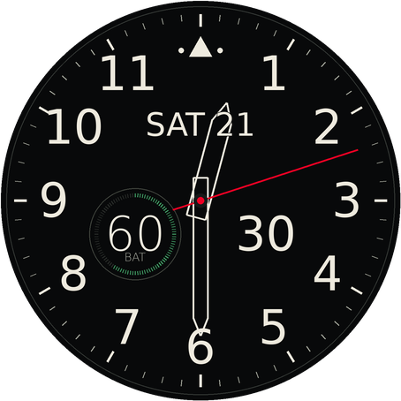
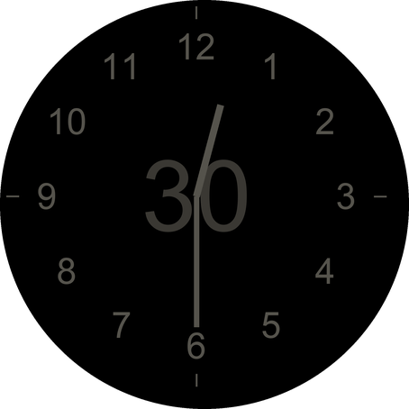
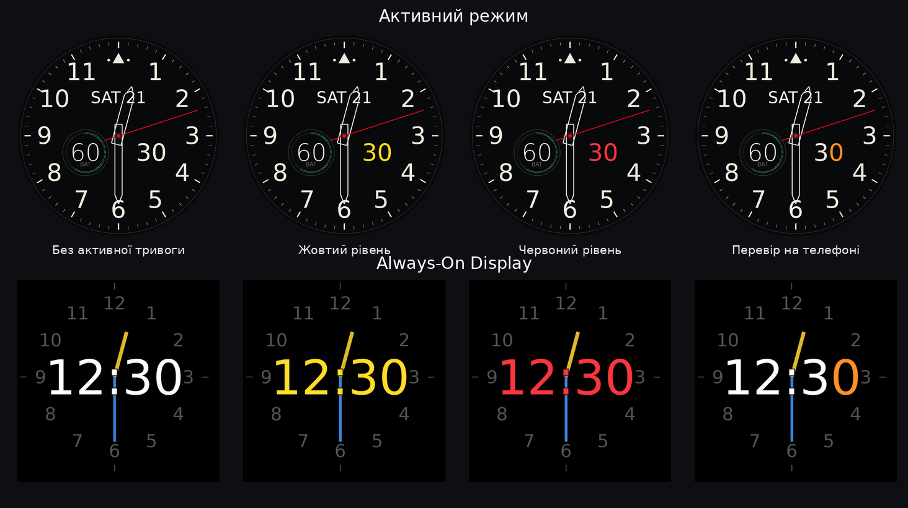

# Night Flieger

[Українська](README.uk.md)

An analog Garmin Connect IQ watch face for the Forerunner 965. The active display shows local time, the weekday and day of the month, battery level, and the exact minute. Always-On Display shows the hands, hour numbers, hour markers, and a large white time readout in the center.

## Watch face preview



| On the display | Meaning |
| --- | --- |
| `SAT 21` at the top | Saturday, the 21st day of the month. |
| `60` above `BAT` on the left | Battery level, shown as a number from 0 to 100. The ring fills clockwise in proportion to the remaining charge. The filled marks are green at 60–100, dark yellow at 30–59, and dark red at 1–29. At zero, all marks are dim. |
| `30` on the right | The current minute. In this example, the hands show 12:30. |

### Always-On preview



The center shows the local time. The hour hand is yellow and the minute hand is blue. Date and battery level appear on the active display.

## Kyiv air alert colors



Top row: active display. Bottom row: Always-On Display.

Night Flieger checks the status of the city of Kyiv through Garmin Connect. With fresh data, the active minute readout and Always-On time are white when no alert is active, yellow at the yellow level, and red at the red level. An orange last digit means the check failed or the source data is more than seven minutes old. Check the alert app on your phone in that case. Garmin schedules checks at five-minute intervals and may run them later. [Status data by Tryvoha.online](https://tryvoha.online/)

## Project structure

- `manifest.xml` defines the app ID, watch face type, and `fr965` target.
- `monkey.jungle` defines the build configuration.
- `source/Flieger.mc` contains the rendering logic, including layout, colors, and Always-On behavior.
- `resources/` contains the launcher icon, resource definitions, and bitmap fonts. To change a font, replace its `.fnt` and `.png` files and update the reference in `resources/resources.xml` if the filenames change. The font license is in `FONT-LICENSE.txt`.

## Build

1. Install the [Garmin Connect IQ SDK](https://developer.garmin.com/connect-iq/sdk/) and download the **Forerunner 965** device profile in SDK Manager. This project has been built with Connect IQ SDK 9.3.0.
2. Open the project folder in VS Code with Garmin's **Monkey C** extension installed. Run **Monkey C: Generate Developer Key** from the Command Palette if you need a signing key. Keep the key outside the repository and use the same key for future updates.
3. Run **Monkey C: Build for Device** and select **Forerunner 965**. If `monkeyc` is on your `PATH`, you can also build from the project root:

   ```sh
   mkdir -p bin
   monkeyc -f monkey.jungle -d fr965 -o bin/FLIEGER.PRG -y /path/to/developer_key.der -l 3 -w -r
   ```

## Test and install

1. Open the Connect IQ Simulator, run `monkeydo bin/FLIEGER.PRG fr965`, and check both the active and Always-On displays.
2. Connect the watch via USB and copy `FLIEGER.PRG` to `GARMIN/APPS`.
3. Disconnect the watch and select **Night Flieger** from the watch face menu. [Garmin sideloading instructions](https://developer.garmin.com/connect-iq/connect-iq-basics/your-first-app/)

Keep the app ID in `manifest.xml` when building updates. If an update signed with a different key fails to install, remove the previous copy from the watch and install the new build.
